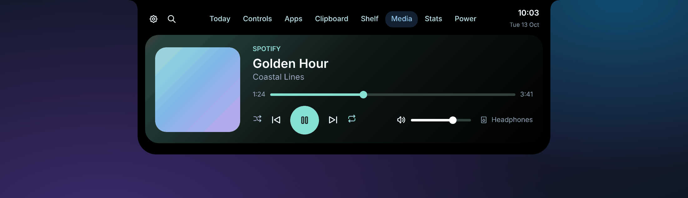
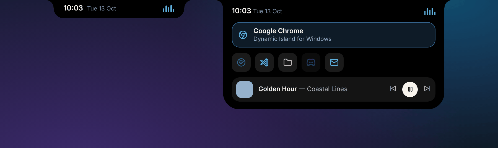
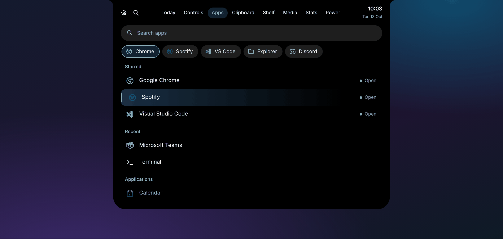
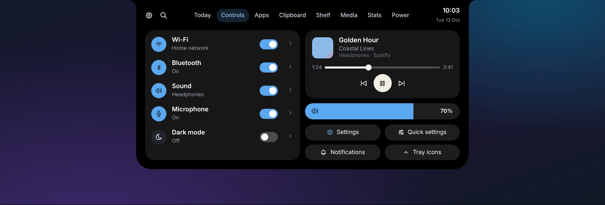
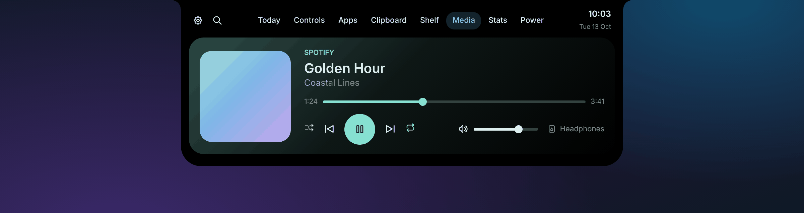
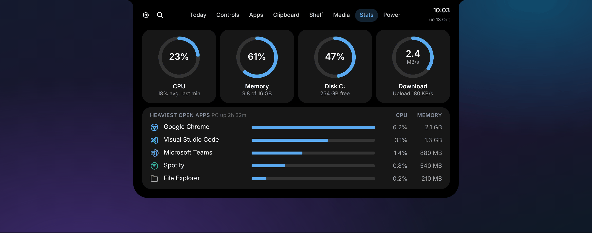
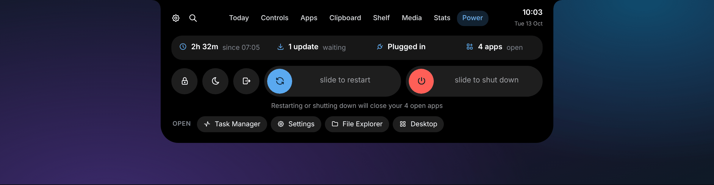

# Dynamic Island for Windows

**An iPhone-style Dynamic Island that replaces the Windows 11 taskbar.**

A small black pill sits at the top of your screen with the time, date and what's playing.
Rest your mouse on it to see your open apps. Click it, and it opens into a full control centre for
your apps, music, clipboard, files, system stats and power options.

---

## Why?

The Windows taskbar takes a strip off the bottom of every screen and is mostly just a row of icons.
Dynamic Island replaces it with something that stays out of the way until you need it:

- **It's small.** Most of the time it's a tidy pill showing the time and date.
- **It moves aside for your work.** When the app underneath is maximised, the island slides up out of sight.
  Rest the mouse at the top edge to bring it back.
- **It's all in one place.** Apps, music, Wi-Fi and Bluetooth, clipboard history, a file shelf, system stats and power
  options all live in one panel, one click away.

## A quick tour

### The pill and the hover tray

The pill shows the time, the date, your battery (on laptops) and little music bars when something's playing.
Rest your mouse on it and it grows into a tray of your open apps. The app you're using is shown at the top with
its window title, and below that are the song controls.

### Apps

Every installed app in one list, with **Starred**, **Recent** and **Applications** sections. Start typing
anywhere to search (initials work too: "vsc" finds Visual Studio Code). Apps that are already open are marked,
and clicking them brings back the window you already have instead of starting a new copy.

### Controls

Switches for Wi-Fi, Bluetooth, sound, microphone and dark mode, with a compact music player and volume
alongside, plus shortcuts to Windows Settings, Quick settings, notifications and tray icons.

### Media

A full player that takes on the colour of the album artwork, with song position, shuffle, repeat, volume and a
speaker/headphone picker. Works with Spotify, browsers, Media Player and anything else that shows up in Windows'
own media controls.

### Stats

Live rings for CPU, memory, disk and network, and the five open apps using the most CPU and memory.

### Power

Up time, Windows Update status, power and open apps at a glance. Lock, sleep and sign out are one click
away, while restart and shut down use **slide to confirm** sliders, so they can't happen by accident.
If Windows has updates waiting, they're installed on the way, just like the Start menu does.

### …and more

- **Today:** a greeting, the weather (now and the next few hours) and a month calendar.
- **Clipboard:** your recent copies, with search, filters (text, images, links) and pinning.
  Copies from password managers are skipped.
- **Shelf:** drop files onto the island to keep them handy, then drag them out into any folder, email or chat.
- **Pop-ups:** the island briefly pops out for volume changes, new songs, Bluetooth devices, USB drives and charging.

### Make it yours

Choose from four island styles and any accent colour.

---

## Getting started

> **Requirements:** Windows 11 and the free **.NET 8 SDK** from Microsoft. The Glass style needs Windows 11 22H2
> or later. Windows 10 (version 2004 or later) may work but hasn't been tested.

1. **Download** this project: click the green **Code** button above, then **Download ZIP**, and unzip it anywhere.
2. **Install the .NET 8 SDK** if you don't already have it. You only need to do this once, and `Build.cmd` opens the
   download page for you if it's missing (choose **SDK 8.0 → Windows → x64**).
3. **Double-click `Build.cmd`.** It builds the app into an `App` folder and offers to start it.
4. The first time, Windows may show a blue **"Windows protected your PC"** box, because the app isn't signed
   by a publisher. Click **More info → Run anyway**.

To start it automatically, right-click the pill and choose **Start with Windows**.

### Getting your taskbar back

- **To quit:** right-click the pill → **Exit Dynamic Island**. Your normal taskbar comes straight back.
- **If the app was force-closed** (for example from Task Manager) and the taskbar is still hidden, double-click
  **`Restore taskbar (emergency).cmd`**.

## Good to know

- **Privacy.** Nothing is collected or sent anywhere, with one exception: the weather on the Today tab.
  It's fetched from [Open-Meteo](https://open-meteo.com), and your town name is looked up with
  [BigDataCloud](https://www.bigdatacloud.com), using only your approximate location.
  Settings and pinned items are kept on your PC in `%AppData%\DynamicIsland`.
- **Limitations.** It works on the main monitor only. Some apps don't allow other programs to jump around in a song
  (Spotify, for one), so scrubbing may not work with them. The battery only shows on PCs that have one.
- **Problems?** Details are saved to `%AppData%\DynamicIsland\errors.log`. Attach that file if you
  [open an issue](../../issues).

The full **[user guide](docs/USER-GUIDE.md)** covers every tab, setting and keyboard shortcut.

## Built with

- C# and WPF on .NET 8, with Windows' own APIs for media, Wi-Fi/Bluetooth, the taskbar and window tracking
- [NAudio](https://github.com/naudio/NAudio) for volume and audio devices
- [Tabler Icons](https://tabler.io/icons) (MIT) for the line-style app icons, downloaded automatically on first build

---

Inspired by the iPhone's Dynamic Island. This is an independent project, not affiliated with or endorsed by
Apple or Microsoft.
